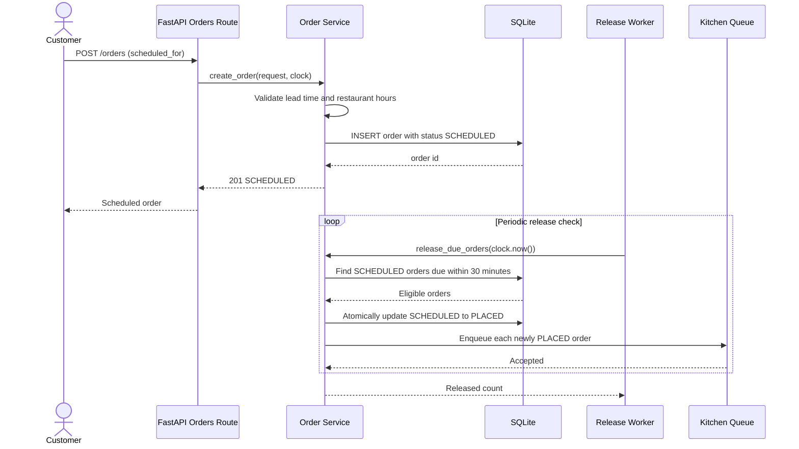

# MiniDash Track A: Scheduled Orders Design

## Database Changes

Track A extends the existing `orders` table and keeps order items unchanged.

### `orders` (modified)

| Column | Type | Constraints / Purpose |
|---|---|---|
| `id` | INTEGER | Existing primary key |
| `restaurant_id` | INTEGER | Existing foreign key to `restaurants(id)` |
| `status` | TEXT | Existing status field; add `scheduled`, `placed`, and `cancelled` values |
| `total_cents` | INTEGER | Existing order total |
| `address` | TEXT | Existing delivery address |
| `created_at` | TEXT | Existing UTC creation timestamp |
| `scheduled_for` | TEXT NULL | Requested delivery time in UTC; required for scheduled orders |
| `released_at` | TEXT NULL | UTC time when a scheduled order transitions to `placed` |
| `cancelled_at` | TEXT NULL | UTC time when an order is cancelled |

The implementation should add an index on `(status, scheduled_for)` so the release worker can efficiently find scheduled orders due for release. Existing immediate orders continue to use their current creation flow; `scheduled_for` remains `NULL` for them.

### `restaurants` (used for validation)

The existing `opens_at` and `closes_at` columns define the restaurant's daily operating window. Scheduling validation compares the requested local restaurant time with this window before inserting the order. The current design does not add a separate schedule table because multi-day or date-specific hours are out of scope.

## REST API

The existing order item representation is reused. Timestamps are ISO 8601 strings and are interpreted as UTC unless an offset is supplied.

### Create a scheduled order

```http
POST /orders
Content-Type: application/json
```

```json
{
  "restaurant_id": 1,
  "address": "123 Main Street",
  "scheduled_for": "2026-11-01T18:30:00Z",
  "items": [
    { "menu_item_id": 1, "quantity": 2 }
  ]
}
```

```text
create_order(request: CreateOrderRequest) -> OrderResponse
```

The route accepts `scheduled_for` as optional for backward compatibility. When present, the service validates the 45-minute minimum, 7-day maximum, restaurant hours, and creates the order with status `scheduled`.

### Retrieve an order

```http
GET /orders/{order_id}
```

```text
get_order(order_id: int) -> OrderResponse
```

The response includes `scheduled_for`, `released_at`, and `cancelled_at` when applicable.

### Cancel a scheduled order

```http
POST /orders/{order_id}/cancel
```

```text
cancel_order(order_id: int) -> OrderResponse
```

Only an order still in `scheduled` status can be cancelled through this route. The service returns a conflict error if the order has already been released to `placed`.

### Release due scheduled orders

```text
release_due_orders(now: datetime) -> int
```

This service operation is invoked by a periodic worker. It atomically selects eligible `scheduled` orders where `scheduled_for <= now + 30 minutes`, changes each to `placed`, and sets `released_at`. The status predicate prevents duplicate release if the worker runs more than once.

## Scheduled Order Sequence



## ADR-001: Injectable Clock Service

**Status:** Accepted  
**Decision:** Use an injectable clock service rather than calling the system clock directly.

### Context

Lead-time validation and automatic release depend on the current time. The rules require a 45-minute minimum, a 7-day maximum, and release exactly 30 minutes before the requested delivery time. Direct calls to `datetime.now()` make these boundary conditions dependent on wall-clock timing and make tests slow or flaky.

### Options

| Option | Advantages | Disadvantages |
|---|---|---|
| Injectable Clock Service | Deterministic tests; exact control of boundary times; one time source for routes, services, and workers | Requires passing a dependency through the service layer |
| System Clock | Minimal code and no dependency plumbing | Difficult to test exact boundaries; tests may need sleeps or patching; risk of inconsistent timestamps |

### Decision and Design

Use a small `Clock` interface with a production implementation backed by the system UTC clock and a fake implementation for tests:

```python
class Clock:
    def now(self) -> datetime:
        ...
```

`create_order` and `release_due_orders` receive a `Clock` instance. Production wiring supplies `SystemClock`; tests supply `FixedClock` or `FakeClock`. All timestamps used for validation and persistence come from the same clock instance.

### Consequences

- Tests can assert behavior at exactly 45 minutes, 7 days, and 30 minutes without waiting.
- Release idempotency and cancellation races can be tested with controlled time and database state.
- The service signatures gain an explicit time dependency, improving clarity but requiring dependency wiring.
